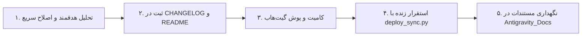

# Fundamental Project Flow (جریان بنیادین توسعه پروژه)

این مستند جریان کار استاندارد، بهینه‌سازی فرآیند توسعه، جلوگیری از لوپ‌های تحلیل طولانی (Anti-Stall)، و چرخه خودکار همگام‌سازی و استقرار فروشگاه **بساط ناب** (`basate-nab`) را تبیین می‌کند.

---

## چرخه ۵ مرحله‌ای بنیادین (The 5-Step Continuous Flow)



### ۱. تحلیل هدفمند و پیشگیری از قفل شدن ایجنت‌ها (Anti-Stall & Targeted Inspection)
* **قانون ضد لوپ CSS/Code:** هرگز فایل‌های بزرگ مانند `assets/css/main.css` را به صورت فله‌ای و خط به خط نخوانید؛ از خواندن‌های بیش از ۱۵۰ خط بدون هدف مشخص پرهیز کنید.
* **جستجوی متمرکز:** با استفاده از جستجوی دقیق متنی یا اسلایس‌های کوچک، مستقیماً بخش مورد نظر (مانند `.top-bar-social`, `.hero-social-pills`, `.site-header`) را بیابید.
* **المان‌های افقی (Horizontal Icons / Flex Layout):** برای آیکون‌های افقی در هدر یا سکشن‌ها، چیدمان به صورت سطر بدون پیچش اعمال شود:
  ```css
  display: flex !important;
  flex-direction: row !important;
  align-items: center !important;
  flex-wrap: nowrap !important;
  gap: 8px !important;
  ```

### ۲. مستندسازی پویا (Living Documentation)
* تغییرات بلافاصله در `CHANGELOG.md` ثبت شود (تحت عنوان‌های `Added`, `Changed`, `Fixed`, `Security`).
* فایل `README.md` در صورت تغییر دستورات، ساختارها یا آدرس‌ها به‌روزرسانی شود.

### ۳. کنترل نسخه و گیت‌هاب (Git & GitHub Sync)
* دستورات زیر برای هر بسته تغییر اجرا گردد:
  ```powershell
  git add .
  git commit -m "feat/fix/docs: descriptive message"
  git push origin main
  ```

### ۴. استقرار خودکار و تایید سلامت سرور (Live Deployment & Verification)
* اعمال خودکار تغییرات روی هاست زنده `https://basate-nab.com/`:
  ```powershell
  python deploy_sync.py
  ```
* تایید وضعیت ۲۰۰ سرور و به‌روزرسانی پوسته بدون نیاز به یادآوری کاربر.

### ۵. بایگانی اسناد سراسری (Persistent Storage)
* ذخیره و نگهداری کلیه مستندات و ران‌بوک‌ها در:
  `C:\Users\Hamed\Documents\Antigravity_Docs\`
